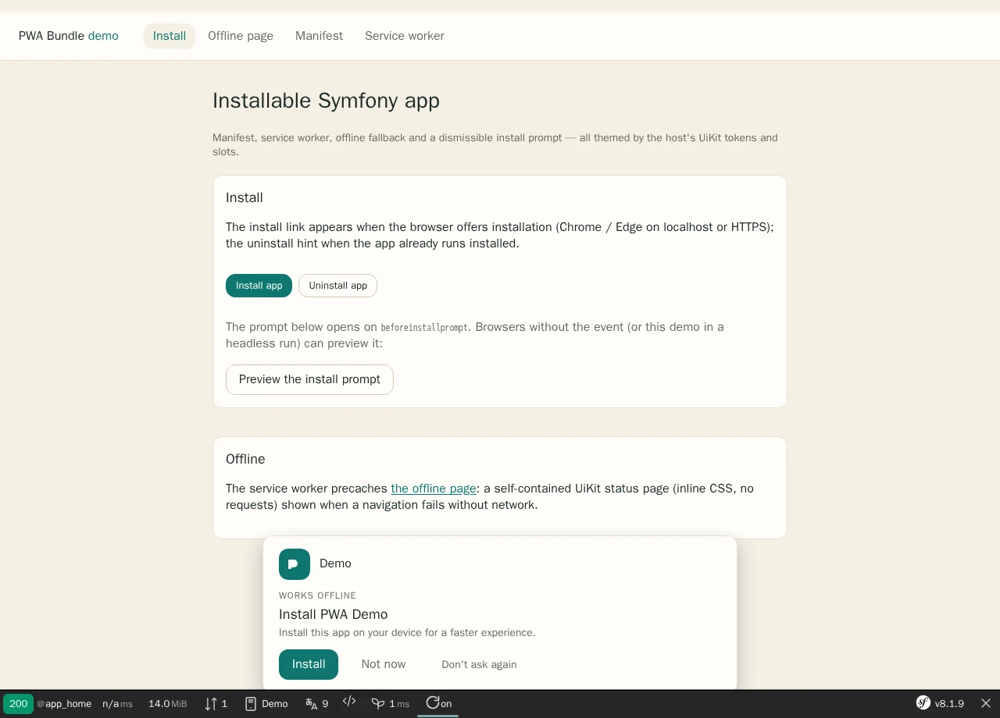
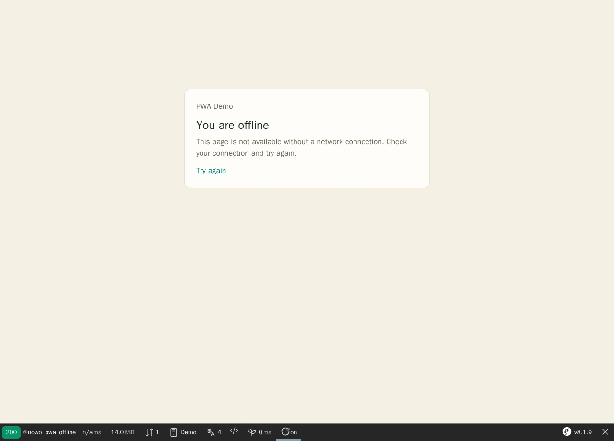

# PWA Bundle

[](https://github.com/nowo-tech/PwaBundle/actions/workflows/ci.yml) [](https://packagist.org/packages/nowo-tech/pwa-bundle) [](https://packagist.org/packages/nowo-tech/pwa-bundle) [](LICENSE) [](https://php.net) [](https://symfony.com) [](https://github.com/nowo-tech/PwaBundle) [](#tests-and-coverage) [](https://codecov.io/gh/nowo-tech/PwaBundle)

> ⭐ **Found this useful?** Give it a **star** on [GitHub](https://github.com/nowo-tech/PwaBundle) so more developers can find it.

Turn any Symfony application into a **Progressive Web App** with a fully configurable manifest, service worker, offline page, and install prompt — no vendor lock-in, no hardcoded assets.


This bundle is **FrankenPHP worker mode friendly**.

This includes running when the kernel is **not** rebooted between requests (`reset_kernel` false); see [FrankenPHP worker audit](docs/FRANKENPHP-WORKER-AUDIT.md). The only runtime blocking I/O, optional Web Push deliveries, is bounded by `web_push.connect_timeout` / `timeout` so a slow push service cannot pin a worker thread ([HTTP timeouts](docs/CONFIGURATION.md#http-timeouts-req-runtime-001)).

<table>
  <tr>
    <td align="center" width="50%">
      
      <br /><sub>Install prompt — host UiKit theme, brand mark from a one-block override</sub>
    </td>
    <td align="center" width="50%">
      
      <br /><sub>Offline fallback — self-contained status page cached by the service worker</sub>
    </td>
  </tr>
</table>

## Features

- **Web App Manifest** generated from `nowo_pwa.yaml` (name, icons, shortcuts, theme, display mode, scope, start URL)
- **Manifest overlay** — implement `ManifestOverlayProviderInterface` (tag `nowo_pwa.manifest_overlay_provider`, autoconfigured) to overlay brand/colors onto the manifest
- **Service worker** with configurable cache strategy (`network-first`, `cache-first`, `stale-while-revalidate`), precache URLs, and offline fallback
- **Twig helpers** `nowo_pwa_head()`, `nowo_pwa_install_prompt()`, `nowo_pwa_install_links()`, and `nowo_pwa_enabled()` with route targeting (`all` / `only` / `except`, route names or URL paths)
- **Web Profiler** panel `nowo_pwa` (manifest/SW status in debug)
- **Install prompt modes** — `banner`, `flash` (inline), or `modal`; dismiss remind / never-ask-again options
- **UiKit page contract** (REQ-UI-003, `nowo-tech/ui-kit-bundle` ^2.2) — widgets on UiKit theme slots and tokens, offline page on the self-contained UiKit status layout ([templates](docs/TEMPLATES.md))
- **Override-friendly** Twig templates with install/offline blocks (`@!NowoPwaBundle` one-block overrides), bundled `pwa.css` tokens, and translations (**en**, **es**, **fr**, **it**, **pt**, **de**, **nl**; REQ-TWIG-001 / REQ-I18N-001)
- **TypeScript client** for SW registration and install banner (Vite build → `pwa.js`)
- **Web Push (optional)** — `WebPushSenderInterface` (minishlink/web-push 11, VAPID, anti-SSRF endpoint guard), dependency checks at compile time, and an opt-in CSRF-protected **test notification** endpoint (`nowo_pwa_push_test`)
- **Push diagnostics** — `push-checks.ts` + Stimulus peer `push-diagnostics` + partial `pwa/push_diagnostics.html.twig` (per-step checklist: support, VAPID, permission, service worker, subscription/key match, server copy)
- **Browser hints** — Stimulus peer `browser-hint` + partials `pwa/browser_hint.html.twig` / `pwa/browser_guide.html.twig` (per-browser install + push help)
- Works with Symfony **7.4+** and **8.x**; no database required

## Installation

```bash
composer require nowo-tech/pwa-bundle
```

```yaml
# config/packages/nowo_pwa.yaml
nowo_pwa:
    manifest:
        name: 'My Application'
        short_name: MyApp
        theme_color: '#0f172a'
        icons:
            - { src: '/icons/icon-192.png', sizes: '192x192', type: image/png }
            - { src: '/icons/icon-512.png', sizes: '512x512', type: image/png }
    service_worker:
        precache_urls: ['/', '/offline']
        offline_url: '/offline'
```

In your base layout:

```twig
<head>
    {{ nowo_pwa_head() }}
</head>
<body>
    
    {{ nowo_pwa_install_prompt() }}
    {{ nowo_pwa_install_links() }}
</body>
```

See [Installation](docs/INSTALLATION.md) and [Configuration](docs/CONFIGURATION.md).

## Documentation

- [Installation](docs/INSTALLATION.md)
- [Configuration](docs/CONFIGURATION.md)
- [Usage](docs/USAGE.md)
- [Contributing](docs/CONTRIBUTING.md)
- [Code of Conduct](CODE_OF_CONDUCT.md)
- [Changelog](docs/CHANGELOG.md)
- [Upgrading](docs/UPGRADING.md)
- [Release](docs/RELEASE.md)
- [Security](docs/SECURITY.md)
- [Engram](docs/ENGRAM.md)
- [Spec-driven development](docs/SPEC-DRIVEN-DEVELOPMENT.md)
- [GitHub Spec Kit](docs/SPEC-KIT.md)

### Additional documentation

- [GitHub Actions CI requirements](docs/GITHUB_CI.md)
- [PSR evaluation (REQ-CS-007)](docs/PSR.md)
- [Templates (UiKit page contract)](docs/TEMPLATES.md)
- [Demo with FrankenPHP](docs/DEMO-FRANKENPHP.md)
- [FrankenPHP worker audit](docs/FRANKENPHP-WORKER-AUDIT.md)

## Tests and coverage

- PHP: 100% (`composer test-coverage-100` enforces `--min-percent=100`)
- TS/JS: 100% (Vitest thresholds in `vitest.config.ts`)

```bash
make test
make test-ts
make test-coverage
make release-check   # includes demo healthcheck on port 8025
```

Playwright end-to-end tests and the README screenshots (WebP under `docs/images/demo/`): `make -C demo/symfony8 test-e2e`
and `make -C demo/symfony8 demo-screenshots` (REQ-DEMO-013).

## License

MIT — see [LICENSE](LICENSE).
